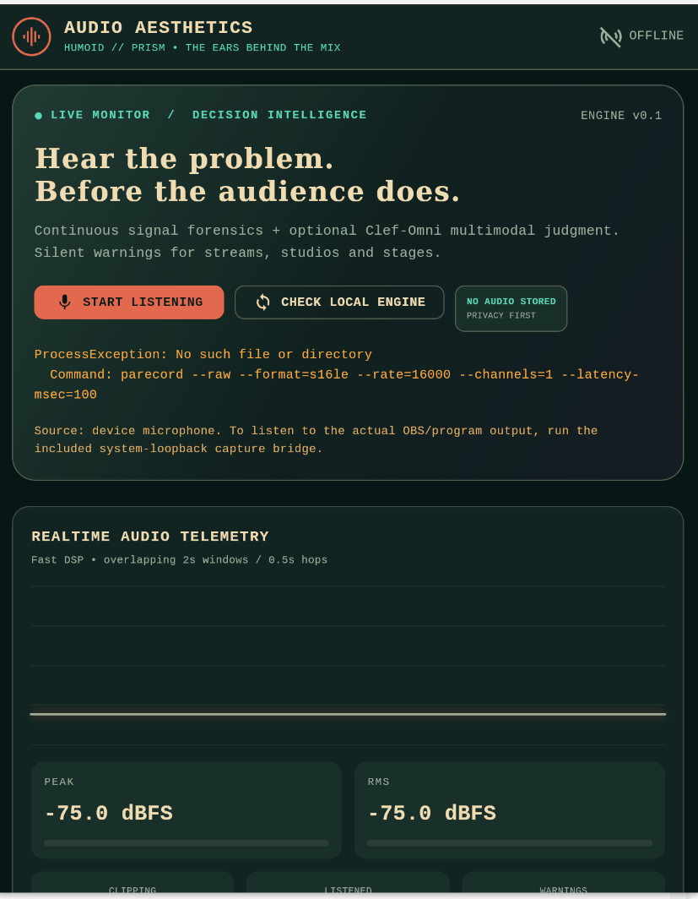
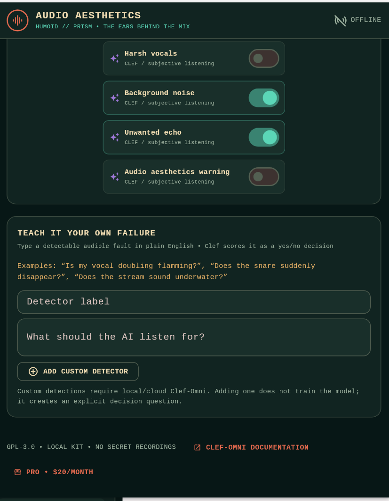

# AUDIO AESTHETICS // PRISM EDITION

**Live, configurable audio fault detection for streamers, musicians, podcast hosts, DJs, and live sound engineers.**

## Credits to twitch.tv/beginbot for the idea ( he created an aesthetics model on stream to rate audio that chat created )
#### Dashboard Preview


#### Audio Monitoring Preview


This is a **runnable Python/Flutter source-code MVP**, inspired by the supplied Humoid PRISM theme and distributed alongside the supplied PRISM source in `prism_reference/`. It is not a claim of a production-trained, benchmarked “audio aesthetics” classifier. The deterministic signal checks work offline. Subjective audio judgments require a genuine Clef-Omni decision-model service configured by you. The storefront can initiate paid Stripe subscriptions after operator setup.

## Quick start: 3 commands (Python backend + sales page)

```bash
cd engine
python -m pip install -r requirements.txt
python run.py
```

Open **http://127.0.0.1:8788** for the storefront, or visit **http://127.0.0.1:8788/docs** for interactive API docs. On Windows/Linux/macOS, `start-local.bat` or `start-local.sh` from the package root creates a virtual environment and launches the engine.

### Run Flutter (Dart client)

Install a recent **Flutter stable** with Dart **3.5 or newer** and the platform toolchain for your target. Existing PRISM ZIP did not include native Flutter runner folders, so scaffold them first:

```bash
cd flutter
flutter create --platforms=android,ios,linux,macos,windows,web .
python tool/enable_audio_permissions.py
flutter pub get
flutter run -d windows      # OR: macos, linux, chrome, android, ios
```

Choose a preset, enable signal checks, and click **START LISTENING**. Microphone audio is transmitted to the loopback Python process as signed PCM16 frames, not an MP3 or simulation. The Flutter UI shows actual RMS and peak meters and displays silent fault warnings. If your source is the **OBS program mix**, select a virtual audio device as the microphone, or use the loopback CLI described below. The phone's `127.0.0.1` is the phone, not your desktop. Web microphones normally require HTTPS except on localhost.

The included `tool/enable_audio_permissions.py` patches generated Android microphone+Internet permissions, a localhost-only cleartext exception, iOS/macOS microphone usage strings and macOS input/network entitlements. Review the modified native files. On Android emulators, use `adb reverse tcp:8788 tcp:8788` to reach the desktop server; physical devices require a secure backend URL/VPN. See [record package](https://pub.dev/packages/record) permission and supported-platform instructions.

### Monitor what OBS/your system actually sends

**Important:** the mobile/desktop Flutter microphone monitor listens to a selected microphone device; it cannot magically hear OBS output. To monitor your program audio use a loopback or virtual audio cable:

```bash
cd engine
pip install soundcard
python -m aesthetics.capture --list-devices
python -m aesthetics.capture --device 0 --preset streamer
```

Pick the correct loopback device **index** based on the device listing. The CLI forwards raw PCM to the same `/ws/audio` WebSocket engine. Audio device capabilities differ by OS; on systems without a loopback source, route the OBS monitor bus to a virtual input. The CLI prints triggered warnings; a lighting console can subscribe to OSC signals.

### Test it even without a microphone

```bash
curl -s -X POST -H "Content-Type: audio/wav" \
  --data-binary @examples/known_fault.wav \
  'http://127.0.0.1:8788/api/analyze-wav?preset=streamer'
```

Run that command **from the project root** (not `engine/`). The bundled five-second WAV has deliberate silence, a quiet section and hard-clipped audio. `/api/analyze-wav` gives signal diagnostics for the whole window; `/ws/audio` provides the live detector, overlapping windows, and hysteresis/cooldowns. It does **not** pretend to have queried Clef while Clef is switched off.

## Included components

```text
Audio_Aesthetics_PRISM_Kit/
  flutter/                   Material 3 Dart dashboard, record PCM capture, websockets
  engine/aesthetics/         numpy DSP, overlapping chunker, FastAPI, Clef, OSC, billing
  engine/tests/              18+ passing pytest cases
  website/                   responsive sales site, plans, checkout and portal UI
  examples/                  known_fault.wav for local validation
  docs/                      modes, API, AI model, security, billing and deployment
  prism_reference/           unchanged supplied Humoid PRISM source and license
  start-local.sh / .bat      create local venv and start Python service
  Dockerfile, docker-compose.yml
  LICENSE                   GPL-3.0 (original PRISM's license preserved)
```

## Available presets and detections

Preset names: **streamer**, **artist**, **guitar**, **vocals**, **levels**, **concert**, **podcast**, **dj**, **mastering**, **custom**. Each preset enables a curated subset of 32 built-in checks. The Flutter dashboard can search by fault name, toggle individual checks, configure BPM and reference pitch, and add user-authored instructions.

**Deterministic signal heuristics** (fast 2s windows at 0.5s hops): clipping, RMS too quiet/high, silence, short dropout, DC bias, low crest factor/overcompression, high-frequency harshness proxy, low-mid mud proxy, sub-bass rumble, stereo anti-correlation, transient-smear proxy, sibilance-band proxy, level jump, beat-grid deviation **only with BPM**, monophonic pitch deviation **only with reference Hz**. These are diagnostic hints, not accurate source-separated vocal levels or certified mastering assessments. A **technical signal-health 0–100 score** summarizes heuristic rule penalties; it is not a subjective artistic score.

**Optional Clef audio judgments** (~10s context with 8s hop, plus fault-triggered 4s windows): buried/hot vocals, unwanted vocal distortion, detuned guitar, offbeat performance, unbalanced mix, reverb wash, feedback howl, monitor bleed, clicks/pops, room resonance, audience masking, harsh vocals, noise floor, echo and generic quality concerns. The artist/mastering profiles also request a separate Clef `score` judgment on a five-level sound-quality scale, exposed as an explicitly uncalibrated **AI aesthetics score**. Additional natural-language detectors are converted to model `noul` yes/no questions. Confidence scores are model estimates, not calibrated probabilities of real physical faults, and may need on-stage tuning.

## AI decision providers

- **DSP-only (default):** no neural model, no API key, no cloud, no subscription.
- **Local Clef-Omni:** set `CLEF_LOCAL_URL=http://127.0.0.1:8088/v1/systemone`, start your own **audio-capable Clef-Omni** compatible inference server, select “Local Clef-Omni” in Flutter. The model weights are *not shipped*. Standard text-only Clef or generic LLM chat APIs will not accept these audio requests.
- **Cloud Clef-Omni:** set `CLOUDFLARE_ACCOUNT_ID`, `CLOUDFLARE_API_TOKEN`; run the backend and choose “Cloud Clef-Omni (Pro)”, supplying an active Pro license key. Cloud mode sends approximately 10-second WAV windows to Cloudflare over HTTPS. This **does not** occur without an explicit choice. Cloud inference is a paid feature and is not included free from Cloudflare.

Cloudflare's [Clef-Omni model](https://developers.cloudflare.com/workers-ai/models/clef-omni/) accepts base64 WAV in an `audio` array and returns typed question scores. It isn't text generation or music creation. Local open weights: [Cloudflare/clef-omni](https://huggingface.co/Cloudflare/clef-omni) and [MLX community 4-bit](https://huggingface.co/mlx-community/clef-omni-4bit) (requires a capable Apple Silicon machine). Review compatible servers and licenses; the local endpoint must implement the actual audio-enabled SystemOne request format. See `docs/MODELS.md`.

## Pro website and payments ($20/month)

The website has a functional Stripe Checkout session endpoint, verified webhook handler, license activation, and subscription customer portal. Checkout displays a **real Stripe payment page** only after you:

1. Create a product and USD **$20 monthly recurring price** in Stripe.
2. Set `STRIPE_SECRET_KEY`, `STRIPE_PRICE_ID`, `STRIPE_WEBHOOK_SECRET`, and `PUBLIC_BASE_URL` using `engine/.env.example` as the guide. Environment variables must be supplied by your shell/deployment platform; `.env` isn't loaded automatically.
3. Configure your Stripe webhook URL at `/api/billing/webhook` and deploy via HTTPS if public.
4. Install the optional Stripe package: `pip install stripe`.

The checkout endpoint checks that the configured Stripe price is **$20.00 USD/month**; secret keys stay on the server. After checkout, a one-time Pro access key is shown; the database stores only its SHA-256 digest. Subscribers manage/cancel billing in the Stripe portal with that key. A lost key requires manual recovery in this MVP. Do not launch publicly without rate limits, bot protection, abuse controls, a recovery mechanism, observability, support, and tax/consumer disclosures. The Community edition does not check licenses.

**Unlimited means monitoring sessions / local engine use are unmetered.** Hosted AI is capacity- and fair-use-dependent because provider API calls cost money. Do not market guaranteed unlimited uncapped cloud inference without validating unit economics and abuse controls.

## Silent light trigger / OSC

Set `AESTHETICS_OSC_PORT=9000` in the engine environment. Whenever a new alert passes hysteresis and cooldown, it transmits a localhost UDP OSC message: address `/aesthetics/alert`, arguments `[string fault_id, string severity, float confidence]`. Connect OBS automation / QLC+ / TouchDesigner / your lighting bridge to this address; no light hardware is automatically controlled without configuring a receiver. This prevents arbitrary network destinations from being sent from the detector engine.

## Automated validation

```bash
cd engine
python -m pip install -r requirements-dev.txt
python -m pytest -q tests
```

Python backend tests run in the build environment. **The Flutter SDK is not available in this environment**, so compilation and native audio permissions / mic capture on devices are **not validated here**. Likewise **real Cloudflare credentials, local 20GB+ model weights, Stripe keys, and physical lights weren't available**, so those external integrations are implemented against documented APIs but not live end-to-end certified. It is a solid implementation starter, not a market-ready safety-critical live FOH product. See `docs/SECURITY.md`.

## Architecture diagram

```text
Input source
   ├─ Flutter device mic → PCM16 audio stream ─┐
   └─ system loopback / OBS virtual input ──────┤
                                              ▼
                                WebSocket /ws/audio
                                              │
                                       ring buffer (32s)
                                              │
                       ┌──────────────────────┴─────────────────────┐
                       ▼                                            ▼
               2s window / 0.5s hop                       10s window / 8s hop
                 RMS, FFT, level /                             WAV + state JSON
                 spectral / pitch                                      │
                       │                                         Clef-Omni
                       │                                    (local or cloud)
                       └──────────────────────┬─────────────────────┘
                                              ▼
                                   alert gate / cooldown
                                              ▼
                               Flutter warning + optional OSC
```

## Licensing

GPL-3.0. The uploaded Humoid PRISM source was GPL-3.0 and is retained unmodified inside `prism_reference/`, including its LICENSE and attributions. New code is provided under the same license. Commercially selling *hosting/support/convenience* is compatible with an open-source edition; any redistributions of GPL-covered combined software must comply with GPL terms. Refer to `LICENSE` and seek legal advice if incorporating third-party model components.

### Optional WLED physical indicator

A runnable OSC-to-WLED light bridge is included: `cd engine && python -m aesthetics.light_bridge --dry-run` prints incoming alert messages; with a WLED device, run `python -m aesthetics.light_bridge --ip 192.168.1.48` after changing the IP to **your** local device. Set `AESTHETICS_OSC_PORT=9000` in the engine environment. The bridge uses a steady amber/red light for three seconds with an attempted restoration of the previous state (no strobing). See `docs/API.md`.
